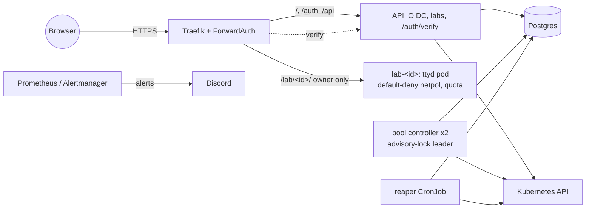

# LabForge

[](https://github.com/gurnoorpannu/LabForge/actions/workflows/ci.yml)
[](https://github.com/gurnoorpannu/LabForge/actions/workflows/images.yml)

A self-service platform that gives you a **temporary, isolated Linux terminal in the browser**.

Log in with Google → **Start lab** → about half a second later (warm pool) you have a real Ubuntu
shell at `https://labs.gurnoor.online/lab/<id>/`. It's destroyed after 45 minutes and everything in it
is wiped. One lab per user; when the cluster is full you get `503` with `Retry-After`.

Each lab is its own Kubernetes namespace: one hardened pod (Ubuntu + ttyd), a default-deny
NetworkPolicy, a quota, and an Ingress that only its owner gets through.



More: [architecture](docs/architecture.md) · [failure modes](docs/failure-modes.md) ·
[runbooks](docs/runbooks/) · [ADRs](docs/adr/) · [deploying to OCI](docs/operations.md)

## Measured results

From [docs/results.md](docs/results.md); every number there has the command that produced it.
Local k3d on a laptop (Apple M4); production numbers come after the OCI deploy.

| | p50 | p95 | n |
|---|---|---|---|
| Click → working terminal, **warm** | 499 ms | 1.01 s | 9 |
| Click → working terminal, **cold** | 2.85 s | 4.84 s | 21 |
| Authenticated request through ForwardAuth (end to end) | 1.3 ms | 48.5 ms | 600 |
| `/auth/verify` server side | 0.64 ms | 5.7 ms | 971 |

- 15 users at once against a cap of 10 → exactly 10 labs, 5 × `503 Retry-After: 60`.
- Isolation suite: **39/39** attacks from inside a lab blocked or contained (API server, kubelets,
  other labs, cloud metadata, platform services, fork bomb, memory and disk bombs).
- 20 parallel starts for 3 warm labs → exactly 3 served warm, no lab assigned twice.

## What's in it

| Area | Details |
|---|---|
| **Isolation** | namespace per lab, `restricted` Pod Security, non-root, read-only root FS, no capabilities, seccomp, no SA token; NetworkPolicy blocks pod/service/**node** CIDRs and cloud metadata (the node CIDR matters: the API server's ClusterIP is DNAT'd to a node IP before policy runs); kubelet PID limit + single-process OOM kill; `tini` as PID 1 |
| **Auth** | Google OIDC (PKCE, state, nonce), hashed server-side sessions in signed HttpOnly cookies, Traefik ForwardAuth with the lab id bound in the Middleware (no path-confusion bypass, [ADR-0001](docs/adr/0001-forwardauth-binds-lab-id.md)) |
| **Lifecycle** | warm pool with Postgres advisory-lock leader election, atomic `FOR UPDATE SKIP LOCKED` claims, partial unique index for one lab per user, two-layer cleanup (reaper + `activeDeadlineSeconds`), drift repair both ways |
| **Observability** | Prometheus metrics (start latency warm/cold, verify latency, pool, reaper heartbeat), 5 alerts with runbooks, Grafana dashboard, Alertmanager → Discord |
| **Delivery** | Helm chart, Argo CD (prune + self-heal), GitHub Actions: tests, helm lint, kubeconform, terraform validate + tflint, ansible-lint; multi-arch images, Trivy gate, GHCR, automatic tag bump |
| **Infra** | Terraform (OCI VCN + 2 Ampere A1 VMs, Always Free), Ansible (hardening, OCI firewall quirks, pinned k3s), cert-manager + Let's Encrypt |

## Run it locally

Needs Docker, [k3d](https://k3d.io), kubectl, helm, Node 22.19+ (24 recommended).

```bash
npm install
make up                       # k3d cluster + build 4 images + Helm chart (~5 min first time)
open http://localhost:8080    # UI; no Google client locally, so mint a session:
kubectl -n labforge exec deploy/labforge-api -- node dist/mint-session.js alice
```

Paste the printed `lf_session=...` into the browser's cookies for `localhost`, or use curl:

```bash
COOKIE=$(kubectl -n labforge exec deploy/labforge-api -- node dist/mint-session.js alice)
curl -s -XPOST localhost:8080/api/labs -H "cookie: $COOKIE"     # -> {"labId":..., "url":..., "startedFrom":"warm"}
```

Tests:

```bash
make test                # unit tests (no cluster)
make test-integration    # k3d + a host Postgres: make dev-db [DB_PORT=5433]; scale the chart's pool-controller to 0 first
make test-e2e            # the deployed chart, through Traefik (includes 2 m expiry checks, ~7 min)
make test-security       # isolation suite; SECURITY_REPORT=file writes the table
make load-test USERS=10  # k6
```

`make help` lists everything. More detail in [deploy/local/README.md](deploy/local/README.md).

## Deploy to OCI

Step by step, including the accounts, secrets and DNS you provide: [docs/operations.md](docs/operations.md).
In short: `make infra-plan` → `make infra-apply` → `make provision` → create Secrets → `make bootstrap`.

## Screenshots (to add)

Capture these once the production deploy is up, into `docs/img/`, and link them here:

- [ ] `ui-start.png`: the UI after login, with **Start lab**
- [ ] `terminal.png`: a lab terminal showing the expiry banner
- [ ] `denied.png`: another user's lab URL returning 403
- [ ] `grafana.png`: the LabForge dashboard during a load test (warm vs cold start panel)
- [ ] `alert-discord.png`: a PoolEmpty alert in Discord with its runbook link
- [ ] `argocd.png`: the Argo CD applications, Synced and Healthy
- [ ] `ci.png`: a green pipeline run (build, Trivy, push, tag bump)

## Repo layout

```
services/   api, pool-controller, reaper, shared (TypeScript, Node 24)
images/lab/ lab image (Ubuntu 24.04 + ttyd + tini)
deploy/     helm/labforge chart, argocd apps, cluster add-ons, monitoring
infra/      terraform (OCI), ansible (k3s), kubelet drop-in
tests/      integration, security, e2e, load (k6), monitoring
docs/       architecture, failure modes, runbooks, ADRs, results, operations
```
