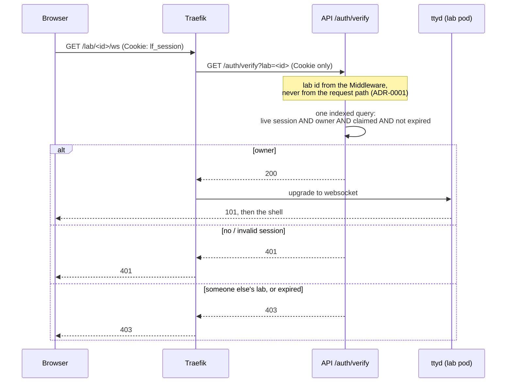
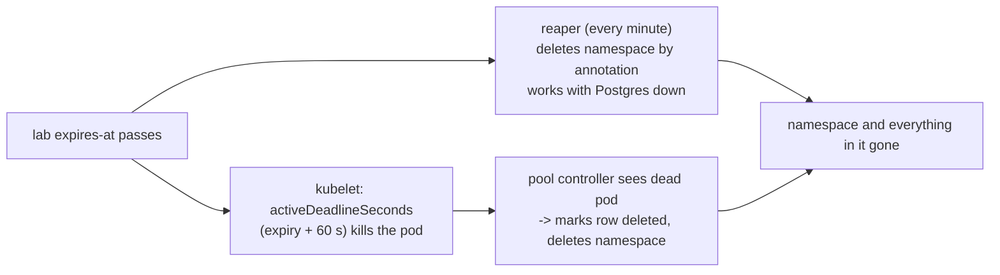

# Architecture

## Components

```mermaid
flowchart LR
  user((Browser))
  subgraph cluster["k3s cluster"]
    traefik["Traefik<br/>(Ingress, TLS, ForwardAuth)"]
    subgraph platform["namespace labforge (restricted PSA, default-deny ingress)"]
      api["labforge-api<br/>Fastify: UI, Google OIDC,<br/>/api/labs, /auth/verify"]
      pool["pool-controller x2<br/>(advisory-lock leader)"]
      reaper["reaper<br/>CronJob, every minute"]
      pg[("Postgres 16<br/>labs, sessions, audit,<br/>heartbeats")]
    end
    subgraph lab["namespace lab-&lt;id&gt; (one per lab)"]
      ing["Ingress /lab/&lt;id&gt;/<br/>+ ForwardAuth Middleware"]
      pod["Pod: tini + ttyd + bash<br/>uid 1000, read-only root,<br/>no caps, seccomp"]
      np["NetworkPolicy<br/>default deny"]
      q["ResourceQuota<br/>+ LimitRange"]
    end
    k8sapi["Kubernetes API"]
    prom["kube-prometheus-stack<br/>Prometheus, Grafana, Alertmanager"]
  end
  discord["Discord"]

  user -- "HTTPS labs.gurnoor.online" --> traefik
  traefik -- "/, /auth, /api" --> api
  traefik -- "/lab/&lt;id&gt;/ (after ForwardAuth 200)" --> pod
  traefik -. "ForwardAuth: /auth/verify?lab=&lt;id&gt;" .-> api
  api --> pg
  pool --> pg
  reaper --> pg
  api -- "create / claim / delete labs" --> k8sapi
  pool -- "keep N warm labs, fix drift" --> k8sapi
  reaper -- "delete expired (by annotation)" --> k8sapi
  prom -- "scrape :9090 /metrics" --> api
  prom -- "scrape :9090" --> pool
  prom -- "alerts" --> discord
```



**Infrastructure:** Terraform creates the OCI network and two Ampere A1 VMs; Ansible hardens them
and installs k3s; Argo CD deploys this repo's Helm chart, cert-manager, monitoring and cluster config.
CI builds and scans the images, pushes them to GHCR and bumps the tag that Argo CD deploys.

## Starting a lab

```mermaid
sequenceDiagram
  autonumber
  participant B as Browser
  participant A as API
  participant P as Postgres
  participant K as Kubernetes API
  B->>A: POST /api/labs (session cookie)
  A->>P: BEGIN; advisory xact lock<br/>1 active lab per user?<br/>claim oldest ready lab (FOR UPDATE SKIP LOCKED)
  alt warm lab claimed
    P-->>A: lab (started_from = warm)
    A->>K: patch namespace (owner, expires-at, state=claimed)
    A->>K: patch pod (expiry annotation, activeDeadlineSeconds from pod start)
    Note over A,K: route already exists (ADR-0009)
  else pool empty, under the cap
    P-->>A: new cold lab row
    A->>K: create namespace, quota, limits, netpol, pod, svc, middleware, ingress
    A->>K: poll pod until Ready
  else at the cap
    A-->>B: 503 + Retry-After: 60
  end
  A-->>B: 201 {labId, url, expiresAt, startedFrom}
```

## One terminal request



## Cleanup layers



## Where things live

| Path | What |
|---|---|
| `services/shared` | config (zod), lab manifest builder, k8s client, Postgres store + migrations, metrics |
| `services/api` | Fastify server: UI, OIDC, sessions, `/auth/verify`, lab API |
| `services/pool-controller` | reconcile loop + leader election |
| `services/reaper` | one-shot expiry job |
| `images/lab` | lab image (Ubuntu 24.04, ttyd, tini) |
| `deploy/helm/labforge` | the chart; `values-local` / `values-prod` / `values-e2e` |
| `deploy/argocd`, `deploy/cluster`, `deploy/monitoring` | GitOps apps, cert-manager + Traefik config, alerts + dashboard |
| `infra/terraform`, `infra/ansible`, `infra/kubelet` | OCI infra, node setup, kubelet drop-in |
| `tests/` | integration (k3d), security (isolation suite), e2e (through Traefik), load (k6), monitoring |
